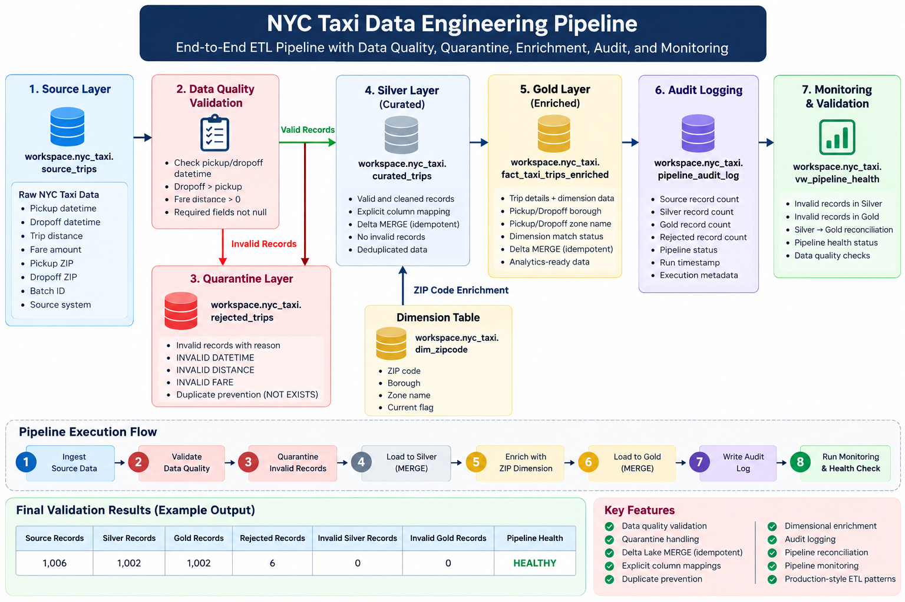
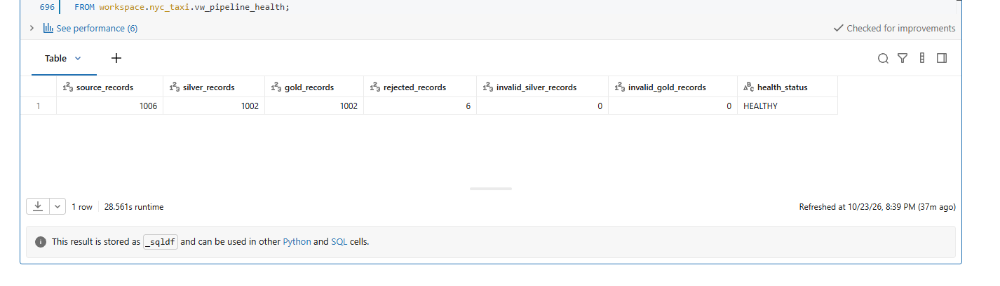

# NYC Taxi Data Engineering Pipeline

An end-to-end data engineering project built with **Databricks, Delta Lake, and SQL** that demonstrates how raw transportation data can be validated, transformed, enriched, quarantined, and monitored using production-style ETL patterns.

## Project Overview

This project implements a multi-layer NYC Taxi data pipeline that processes raw trip records and converts them into clean, analytics-ready data.

The pipeline was designed around common production data engineering requirements including:

- Data quality validation
- Invalid-record quarantine
- Silver and Gold data layers
- Delta Lake MERGE operations
- Idempotent data processing
- Duplicate prevention
- Dimensional enrichment
- Audit logging
- Pipeline reconciliation
- Pipeline health monitoring

## Architecture

## Technology Stack

| Technology | Purpose |
|---|---|
| Databricks | Data engineering and pipeline execution |
| Apache Spark SQL | Data transformation and validation |
| Delta Lake | Reliable tables and MERGE operations |
| SQL | ETL logic, quality checks, enrichment and monitoring |
| GitHub | Source control and project documentation |

## Pipeline Flow

### 1. Source Layer

Raw NYC Taxi trip records are stored in the `source_trips` table.

The source contains trip information including pickup and drop-off timestamps, trip distance, fare amount, ZIP codes, batch information, processing timestamps, and source-system metadata.

### 2. Data Quality Validation

Before records enter the curated layer, the pipeline validates important business rules.

Examples include:

- Pickup and drop-off timestamps must exist.
- Drop-off time must occur after pickup time.
- Trip distance must be greater than zero.
- Fare amount must be greater than zero.

Records that fail these checks are prevented from entering downstream analytical layers.

### 3. Quarantine Layer

Invalid records are written to `rejected_trips`.

Each rejected record receives a rejection reason such as:

- `INVALID DATETIME`
- `INVALID DISTANCE`
- `INVALID FARE`

The quarantine logic uses explicit column mapping and duplicate protection so rerunning the pipeline does not repeatedly insert the same rejected record.

### 4. Silver Layer

Valid records are loaded into `curated_trips`.

A Delta Lake `MERGE` operation is used to make the load idempotent.

This means rerunning the pipeline with the same source records does not continually create duplicate Silver records.

### 5. Dimensional Enrichment

Silver records are enriched using the `dim_zipcode` dimension.

The enrichment adds attributes such as:

- Pickup borough
- Pickup zone name
- Dimension match status

The pipeline identifies whether a trip successfully matched a current ZIP-code dimension record.

### 6. Gold Layer

The enriched records are loaded into `fact_taxi_trips_enriched`.

This table represents the analytics-ready Gold layer and contains both trip information and dimensional attributes.

The Gold load also uses Delta Lake `MERGE` logic to support repeatable pipeline execution.

### 7. Audit Logging

Pipeline execution metrics are written to `pipeline_audit_log`.

The audit process captures metrics including:

- Source record count
- Silver record count
- Gold record count
- Rejected record count
- Pipeline status
- Run timestamp

This provides traceability into pipeline executions.

### 8. Data Quality Monitoring

A pipeline health view performs post-load validation.

The monitoring layer checks:

- Invalid records remaining in Silver
- Invalid records remaining in Gold
- Silver-to-Gold record reconciliation
- Overall pipeline health

## Final Validation Results

The completed pipeline produced the following validation results:

### Databricks Execution Result

The following output shows the final end-to-end pipeline health validation executed in Databricks.

| Metric | Result |
|---|---:|
| Source Records | 1,006 |
| Silver Records | 1,002 |
| Gold Records | 1,002 |
| Rejected Records | 6 |
| Invalid Silver Records | 0 |
| Invalid Gold Records | 0 |
| Pipeline Health | **HEALTHY** |

Silver-to-Gold reconciliation also passed, and duplicate validation found no duplicate Gold records using the selected business key.

## Idempotency

An important goal of this project was ensuring that pipeline reruns are safe.

Two patterns are used:

**Silver and Gold**

Delta Lake `MERGE` prevents already-processed records from being inserted repeatedly.

**Quarantine**

`NOT EXISTS` checks prevent the same rejected record from being written repeatedly.

During development, a column-order issue caused by relying on implicit column mapping was identified. The pipeline was corrected to use explicit column mappings, demonstrating the importance of avoiding `SELECT *` when schemas differ.

## Data Quality Strategy

The pipeline follows the principle:

Raw Data
   |
Validate
   |
   +---- Valid ------> Silver ------> Gold
   |
   +---- Invalid ----> Quarantine

This protects downstream analytical datasets from known invalid records while retaining rejected data for investigation.

## Key Data Engineering Concepts Demonstrated

- ETL pipeline development
- Medallion-style data architecture
- Data quality validation
- Quarantine/error handling
- Delta Lake MERGE
- Idempotent pipelines
- Duplicate prevention
- Dimensional enrichment
- Slowly changing dimension concepts
- Audit logging
- Pipeline reconciliation
- Pipeline monitoring
- Production debugging

## Example Pipeline Health Check

sql
SELECT
    source_records,
    silver_records,
    gold_records,
    rejected_records,
    invalid_silver_records,
    invalid_gold_records,
    health_status
FROM workspace.nyc_taxi.vw_pipeline_health;

Expected validated output:

source_records          1006
silver_records          1002
gold_records            1002
rejected_records        6
invalid_silver_records  0
invalid_gold_records    0
health_status            HEALTHY

## Repository Contents

nyc-taxi-data-engineering-pipeline/
|
|-- NYC_Taxi_ETL_Final.py
|-- README.md

`NYC_Taxi_ETL_Final.py` is a Databricks source-format notebook containing the final ETL pipeline implementation.

## Key Takeaway

This project demonstrates how a data pipeline can go beyond simply moving data from one table to another.

The pipeline validates incoming data, isolates bad records, safely processes repeatable loads, enriches curated records with dimensional information, maintains audit information, and validates downstream data quality before declaring the pipeline healthy.
